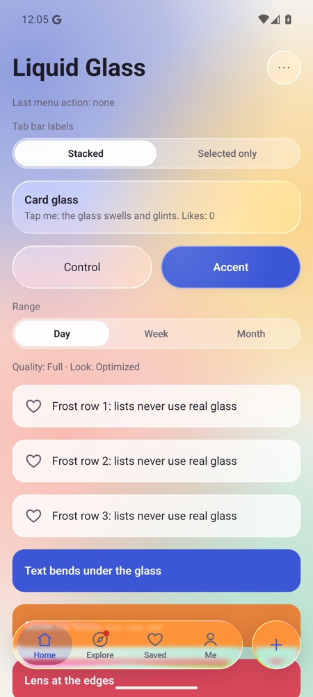
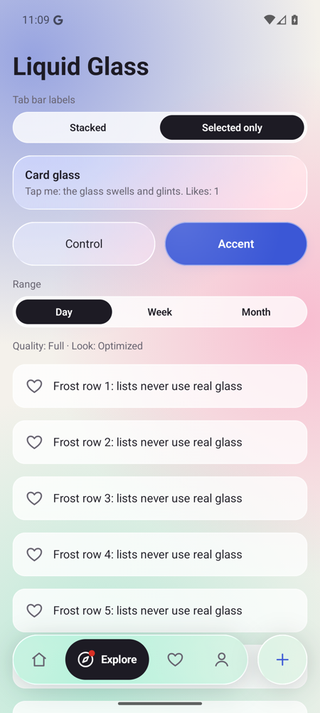
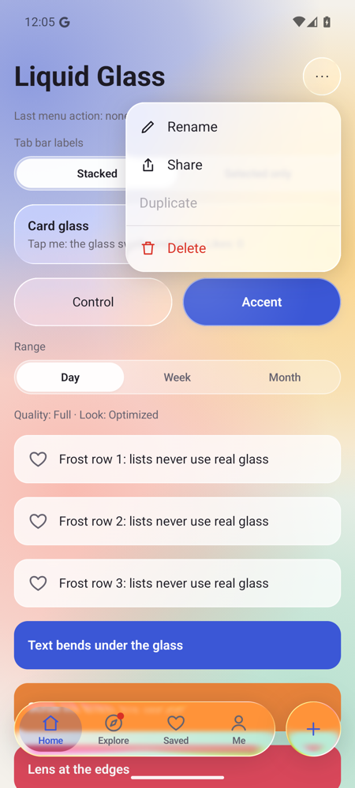

# Liquid Glass for Jetpack Compose

Liquid glass surfaces, a floating tab bar, a segmented control and a droplet menu for Android, built on Jetpack Compose. The glass
refracts what is behind it (lens, chromatic aberration, highlight), reacts to touch (swell, tilt, glint) and adapts to
the device: full glass on Android 13+, lighter glass on Android 12, a cheap frosted look on older or low-RAM devices and
in Battery Saver.

Tiếng Việt: [README.vi.md](README.vi.md)

| Stacked tab labels | Selected-only tab labels | Droplet menu |
|---|---|---|
|  |  |  |

*Sample app on the Android 16 emulator, with `overlaySamplesContent = true`.*

- [Install](#install)
- [Quick start](#quick-start)
- [Guide](#guide): theme · brand colors · reduce effects · screens · glass blocks · tab bar · segmented control · menu · device tiers · do and don't · troubleshooting
- [API](#api) · [Device tiers](#device-tiers) · [Performance rules](#performance-rules) · [Accessibility](#accessibility)

## Install

Add JitPack to `settings.gradle.kts`:

```kotlin
dependencyResolutionManagement {
    repositories {
        google()
        mavenCentral()
        maven("https://jitpack.io")
    }
}
```

Then the dependency:

```kotlin
dependencies {
    implementation("com.github.ntvien:liquid-glass:v0.3.0")
}
```

JitPack uses the git tag as the version, so the `v` is part of it. Releases: [GitHub tags](https://github.com/ntvien/liquid-glass/tags).

Requirements: minSdk 26, compileSdk 37, Jetpack Compose (BOM 2026.09.00 or newer), Kotlin 2.4 or newer.

## Quick start

Three steps: wrap the app in `LiquidGlassTheme`, put each screen in a `LiquidGlassScene`, use glass components inside.

```kotlin
LiquidGlassTheme {
    LiquidGlassScene(background = { MyBackground() }) {
        LiquidSurface(Modifier.statusBarsPadding().padding(16.dp).fillMaxWidth()) {
            BasicText("Hello glass")
        }
    }
}
```

The `sample` module shows every piece on one screen. Every snippet in this guide is compiled in
[`sample/…/guide/GuideSnippets.kt`](sample/src/main/kotlin/io/github/ntvien/liquidglass/sample/guide/GuideSnippets.kt).

## Guide

### 1. Set up the theme

Call `enableEdgeToEdge()` so content draws behind the system bars, then wrap your content once:

```kotlin
class MainActivity : ComponentActivity() {
    override fun onCreate(savedInstanceState: Bundle?) {
        enableEdgeToEdge()
        super.onCreate(savedInstanceState)
        setContent {
            LiquidGlassTheme { // light/dark colors follow the system by default
                AppRoot()
            }
        }
    }
}
```

`LiquidGlassTheme` measures the device once (Android version, low-RAM, high-end or not) and follows Battery Saver live.
It works next to Material or your own theme: put it inside them.

### 2. Brand colors

Start from `GlassColors.light()` / `dark()` and change what your brand needs:

```kotlin
@Composable
fun BrandTheme(dark: Boolean, content: @Composable () -> Unit) {
    val brandBlue = Color(0xFF0A84FF)
    val colors = if (dark) {
        GlassColors.dark().copy(accent = brandBlue, accentSoft = brandBlue.copy(alpha = 0.2f))
    } else {
        GlassColors.light().copy(
            accent = brandBlue,
            accentSoft = brandBlue.copy(alpha = 0.16f),
            selectedFill = brandBlue,
            selectedContent = Color.White,
        )
    }
    LiquidGlassTheme(colors = colors, content = content)
}
```

| Color | Used for |
|---|---|
| `content`, `contentMuted` | text and icons on glass, unselected tabs |
| `accent`, `accentSoft`, `onAccent` | accent button, accent glass |
| `tabSelectedFill`, `tabSelectedContent` | selected tab of the stacked tab bar: droplet, icon and label |
| `chromeFill` | tint of floating glass (tab bar): dark glass in the dark theme |
| `selectedFill`, `selectedContent` | selected pill of the selected-only tab bar |
| `raisedFill` | light glass raised above a track: the selected segment of the segmented control |
| `badge` | tab badge dot |
| `glassFill`, `glassFillStrong`, `glassFillOpaque`, `glassStroke`, `glassHighlight`, `glassShadow` | the glass itself and its frosted fallback |

Read them anywhere with `LiquidGlassTheme.colors`.

### 3. Look and "Reduce effects"

```kotlin
@Composable
fun SettingsAwareTheme(reduceEffects: Boolean, content: @Composable () -> Unit) {
    LiquidGlassTheme(
        look = GlassLook.Auto,          // Rich on high-end devices, Optimized elsewhere
        reduceEffects = reduceEffects,  // from your settings screen: true = frosted glass everywhere
        overlaySamplesContent = null,   // null: content refraction only with Rich / high-end devices; true: everywhere
        content = content,
    )
}
```

Offer a "Reduce effects" switch in your settings for people who prefer less transparency or want to save battery.

**Floating glass and the content behind it.** The tab bar and menus always refract the background. Refracting the
scrolling content under them too (text and images bend at the edges) looks most like real glass, and costs the most.
- **Cost:** the largest of the whole glass. Galaxy S23 Ultra, janky frames while scrolling: 97 % with it, 46 % without;
  frames late by more than 4 ms: 16 % vs 3 % (see [Performance rules](#performance-rules)).
- **Default:** on with `GlassLook.Rich` and on high-end devices (Media Performance Class ≥ 13), off elsewhere.
- **Turn it on everywhere:** pass `overlaySamplesContent = true`, after measuring your screens. `false` turns it off
  everywhere.

### 4. A screen with glass

Each screen has exactly one `LiquidGlassScene`. The `background` is what the glass refracts; the content goes inside.

```kotlin
@Composable
fun BasicScreen() {
    LiquidGlassScene(
        background = { LiquidGradientBackground() },
    ) {
        Column(
            Modifier.fillMaxSize().statusBarsPadding().padding(16.dp),
            verticalArrangement = Arrangement.spacedBy(16.dp),
        ) {
            LiquidSurface(Modifier.fillMaxWidth()) {
                BasicText("Hello glass")
            }
        }
    }
}
```

A photo works well as a background:

```kotlin
LiquidGlassScene(
    background = {
        Image(wallpaper, contentDescription = null, contentScale = ContentScale.Crop, modifier = Modifier.fillMaxSize())
    },
) { /* content */ }
```

Background rules:
- Draw it **once**. A bitmap or a photo is ideal. A gradient redrawn every frame repaints the whole screen behind every glass element;
  `LiquidGradientBackground` draws its blobs once into a quarter-resolution bitmap. Pass `baseColor` and up to 4
  `blobColors` for your brand.
- Keep it smooth (gradients, blurred photos). Then the glass needs no blur and stays cheap.
- Glass placed in the content refracts the background. Glass placed in `overlay` (the tab bar) also refracts the
  scrolling content on capable devices.

### 5. Glass blocks

```kotlin
// Card (static)
LiquidSurface(Modifier.fillMaxWidth()) {
    BasicText("Today")
}

// Pressable card: swells, tilts and glints on touch
LiquidSurface(Modifier.fillMaxWidth(), onClick = onOpen, onClickLabel = "Open details") {
    BasicText("Tap me")
}

// Secondary button
LiquidSurface(
    modifier = Modifier.height(52.dp),
    style = GlassDefaults.control(),
    shape = GlassDefaults.PillShape,
    contentPadding = PaddingValues(horizontal = 20.dp),
    onClick = onOpen,
) { BasicText("Later", modifier = Modifier.align(Alignment.Center)) }

// Primary button in the accent color
val accent = GlassDefaults.accent()
LiquidSurface(
    modifier = Modifier.height(52.dp),
    style = accent,
    shape = GlassDefaults.PillShape,
    contentPadding = PaddingValues(horizontal = 20.dp),
    onClick = onSave,
) { BasicText("Save", style = TextStyle(color = accent.contentColor), modifier = Modifier.align(Alignment.Center)) }

// Round icon button
LiquidSurface(
    modifier = Modifier.size(52.dp),
    style = GlassDefaults.control(),
    shape = GlassDefaults.PillShape,
    contentPadding = PaddingValues(14.dp),
    onClick = onAdd,
    onClickLabel = "Add",
) { Image(plusIcon, contentDescription = null) }
```

Which preset where:

| Preset | Use for | Avoid for |
|---|---|---|
| `GlassDefaults.chrome()` | tab bar, floating header, floating button | cards in a list |
| `GlassDefaults.card()` (default) | hero and large cards, a few per screen | every list row |
| `GlassDefaults.control()` | glass buttons, round buttons | many repeated small items |
| `GlassDefaults.accent()` | the primary button | — |
| `GlassDefaults.frost()` | list rows, chips, input backgrounds | the tab bar |

Shapes: `GlassDefaults.CardShape` (24 dp), `ControlShape` (16 dp), `PillShape` (fully rounded), and the iOS-style
continuous corners `ContinuousCardShape` (24 dp) and `ContinuousPillShape`. Continuous corners are drawn with a path:
keep them for a few large blocks (the tab bar and its droplet, hero cards). `LiquidSurface` uses `ContinuousCardShape`
by default for real glass and `CardShape` for frost.

**Your own recipe**: copy a preset and change only what you need:

```kotlin
val thickGlass = GlassDefaults.card().copy(lensHeight = 20.dp, lensAmount = 32.dp)
LiquidSurface(Modifier.fillMaxWidth(), style = thickGlass) { BasicText("Thicker lens") }
```

**Any composable as glass**: the modifier draws glass behind it:

```kotlin
Box(
    Modifier
        .size(120.dp)
        .liquidGlass(GlassDefaults.control(), GlassDefaults.CardShape, rememberGlassInteraction()),
)
```

**Long lists**: use frosted rows; they never sample the background, so scrolling stays smooth:

```kotlin
LazyColumn(verticalArrangement = Arrangement.spacedBy(8.dp)) {
    items(items) { item ->
        LiquidSurface(Modifier.fillMaxWidth(), style = GlassDefaults.frost(), shape = GlassDefaults.ControlShape) {
            BasicText(item)
        }
    }
}
```

### 6. Tab bar

Put the tab bar in the `overlay` of the scene, aligned to the bottom:

```kotlin
@Composable
fun TabBarScreen() {
    var tab by rememberSaveable { mutableStateOf("home") }
    val homeList = rememberLazyListState()
    val scope = rememberCoroutineScope()
    LiquidGlassScene(
        background = { LiquidGradientBackground() },
        overlay = {
            LiquidTabBar(
                tabs = listOf(
                    LiquidTab("home", "Home", homeIcon),
                    LiquidTab("search", "Search", searchIcon),
                    LiquidTab("saved", "Saved", heartIcon, badge = true),
                    LiquidTab("me", "Me", personIcon),
                ),
                selectedKey = tab,
                onSelect = { tab = it },
                // Tapping the open tab again scrolls its list to the top.
                onReselect = { if (it == "home") scope.launch { homeList.animateScrollToItem(0) } },
                modifier = Modifier.align(Alignment.BottomCenter),
            )
        },
    ) {
        when (tab) {
            "home" -> HomeList(homeList)
            else -> Box(Modifier.fillMaxSize())
        }
    }
}
```

Give scrolling content room so its last item ends above the floating bar:

```kotlin
val top = WindowInsets.statusBars.asPaddingValues().calculateTopPadding()
LazyColumn(
    state = state,
    contentPadding = PaddingValues(start = 16.dp, end = 16.dp, top = top + 16.dp, bottom = LiquidTabBarDefaults.contentBottomPadding()),
) { /* … */ }
```

**Selected-only labels with a round action button:**

```kotlin
LiquidTabBar(
    tabs = listOf(LiquidTab("home", "Home", homeIcon), LiquidTab("saved", "Saved", heartIcon), LiquidTab("me", "Me", personIcon)),
    selectedKey = tab,
    onSelect = { tab = it },
    labels = LiquidTabLabels.SelectedOnly,
    action = {
        LiquidSurface(
            modifier = Modifier.size(LiquidTabBarDefaults.Height),
            style = GlassDefaults.chrome(),
            shape = GlassDefaults.PillShape,
            contentPadding = PaddingValues(20.dp),
            onClick = onAdd,
            onClickLabel = "Add",
        ) { Image(plusIcon, contentDescription = null) }
    },
    modifier = Modifier.align(Alignment.BottomCenter),
)
```

| Labels | Looks like | Good for |
|---|---|---|
| `LiquidTabLabels.Stacked` (default) | every tab: icon above label, soft tinted droplet behind the selected one | 4–5 tabs |
| `LiquidTabLabels.SelectedOnly` | selected tab grows into a pill with icon + label, others icon only | 3–5 tabs with clear icons and short labels |

**With Navigation Compose:**

```kotlin
val nav = rememberNavController()
val route = nav.currentBackStackEntryAsState().value?.destination?.route ?: "home"
LiquidGlassScene(
    background = { LiquidGradientBackground() },
    overlay = {
        LiquidTabBar(
            tabs = listOf(LiquidTab("home", "Home", homeIcon), LiquidTab("me", "Me", personIcon)),
            selectedKey = route,
            onSelect = { key ->
                nav.navigate(key) {
                    popUpTo(nav.graph.findStartDestination().id) { saveState = true }
                    launchSingleTop = true
                    restoreState = true
                }
            },
            modifier = Modifier.align(Alignment.BottomCenter),
        )
    },
) {
    NavHost(nav, startDestination = "home") {
        composable("home") { HomeScreen() }
        composable("me") { ProfileScreen() }
    }
}
```

Built-in behavior: the droplet slides and bounces, you can drag it across the bar, a light haptic tick confirms the
change, the bar slides away while the keyboard is open (`hideWhenImeVisible = false` to keep it), and with a system font
scale of 130 % or more only icons are shown. Use 24 dp outline icons and one-word labels.

### 7. Segmented control

For 2–4 short options inside a screen. Animate the content in the direction of the change:

```kotlin
var range by rememberSaveable { mutableIntStateOf(0) }
LiquidSegmentedControl(listOf("Day", "Week", "Month"), range, { range = it })
AnimatedContent(
    targetState = range,
    transitionSpec = {
        val direction = if (targetState > initialState) 1 else -1
        (slideInHorizontally(tween(280)) { it / 6 * direction } + fadeIn(tween(280)))
            .togetherWith(fadeOut(tween(160)))
    },
    label = "range",
) { selected -> RangeContent(selected) }
```

By default the track is clear glass and the selected option is a **light glass pill raised above it**
(`GlassColors.raisedFill`), as on iOS 26; the selected label is bolder. Other looks through the color parameters:

```kotlin
// Accent pill
LiquidSegmentedControl(
    options, range, { range = it },
    indicatorColor = LiquidGlassTheme.colors.accent,
    selectedTextColor = LiquidGlassTheme.colors.onAccent,
)
```

More than 4 options or long labels: use a horizontally scrolling row of chips (`LiquidSurface` with
`GlassDefaults.frost()` and `PillShape`) instead.

### 8. Menu

A glass button that opens an iOS 26 style menu:
- **Open:** the menu grows out of the button like a glass droplet, overshoots a little and bounces back; the items
  appear one after another.
- **Choose:** tap an item, or press the button, drag the finger down to an item and release. A light haptic tick marks
  every item the finger crosses.
- **Close:** tap outside, press Back, or choose an item; the menu shrinks back into the button.

```kotlin
LiquidMenuButton(
    items = listOf(
        LiquidMenuItem("Rename", editIcon, onClick = onRename),
        LiquidMenuItem("Share", shareIcon, onClick = onShare),
        LiquidMenuDivider,
        LiquidMenuItem("Delete", trashIcon, destructive = true, onClick = onDelete),
    ),
    contentDescription = "More",
    modifier = Modifier.size(44.dp),
) { Image(moreIcon, contentDescription = null) }
```

| Entry or parameter | Notes |
|---|---|
| `LiquidMenuItem(label, icon, destructive, enabled, onClick)` | `destructive = true` draws it in the badge color (delete); `enabled = false` dims it and it cannot be chosen |
| `LiquidMenuDivider` | line between groups |
| `menuWidth` | width of the menu, 250 dp by default |

Placement:
- The menu opens below the button, or above it when there is no room below.
- It lines up with the side of the screen the button is on.

Put the button anywhere inside a `LiquidGlassScene`: the menu draws on the scene's top layer (above the tab bar) as
real glass. Outside a scene it opens in a popup with the frosted look.

Make the button at least 44 dp.

### 9. Adapt to the device

Read the chosen tier when your own decorations should follow it:

```kotlin
val showSparkles = LiquidGlassTheme.quality != GlassQuality.Off
```

`LiquidGlassTheme.look` tells whether the device got `Rich` or `Optimized`.

### Do and don't

| Do | Don't |
|---|---|
| One `LiquidGlassTheme` for the app, one `LiquidGlassScene` per screen | Nest scenes, or put glass outside a scene and expect refraction |
| Draw the background once (bitmap, photo) | Animate a full-screen gradient every frame |
| ≤ 6 real glass elements per screen, frost for repeated items | Real glass on every list row |
| `RoundedCornerShape` for repeated items; continuous corners only on a few large blocks | Continuous or other path shapes on list rows and chips |
| Keep text on glass at 4.5:1 contrast against the brightest part of the background | Put long text on a busy photo |
| Measure a release build | Judge smoothness on a debug build |

### Troubleshooting

| Problem | Cause and fix |
|---|---|
| Glass looks flat and frosted, no lens | No `LiquidGlassTheme` around it, the element is outside a `LiquidGlassScene`, the device runs Android 12 or lower, Battery Saver is on, or `reduceEffects = true` |
| Tab bar looks like white plastic, no lens | Background too pale (use strong color blobs, 35–60 % alpha, as `LiquidGradientBackground` does) or Android 12 (no lens). By default the bar refracts only the background; `overlaySamplesContent = true` also bends the content scrolling under it (measure first) |
| Last list item hidden behind the tab bar | Add `LiquidTabBarDefaults.contentBottomPadding()` to the list's bottom padding |
| Tab bar disappears when typing | Intended. Pass `hideWhenImeVisible = false` to keep it |
| Scrolling stutters | Too much real glass on screen, background redrawn every frame, or a debug build. See [Performance rules](#performance-rules) |
| Text on glass is hard to read | Use `GlassStyle.contentColor` of the style, tint the glass (`style.copy(surface = …)`), or calm the background |

## API

| API | What it does |
|---|---|
| `LiquidGlassTheme(colors, look, reduceEffects, overlaySamplesContent)` | Root. Chooses `GlassQuality` and `GlassLook` once, follows Battery Saver. Read values with `LiquidGlassTheme.colors / quality / look` |
| `GlassColors.light()` / `dark()` / `copy(...)` | Colors of glass and components |
| `LiquidGlassScene(background, overlay, content)` | Frame of a screen with glass. One per screen |
| `LiquidGradientBackground(dark, baseColor, blobColors)` | Ready-made scene background: soft color blobs drawn once into a quarter-resolution bitmap |
| `Modifier.liquidGlass(style, shape, interaction)` | Draws glass behind any element |
| `GlassDefaults.chrome() / card() / control() / accent() / frost()` | Presets, plus `CardShape`, `ControlShape`, `PillShape`, `ContinuousCardShape`, `ContinuousPillShape` |
| `GlassStyle`, `GlassKind` | Make your own recipe (start from a preset and `copy`) |
| `rememberGlassInteraction()` | Press effect: swell, tilt toward the finger, glint |
| `LiquidSurface` | A glass block; with `onClick` it is a button |
| `LiquidTabBar` + `LiquidTab` + `LiquidTabLabels` + `LiquidTabBarDefaults` | Floating tab bar with a water-droplet indicator, `Stacked` or `SelectedOnly` labels, haptics, reselect, badge, hides with the keyboard |
| `LiquidSegmentedControl` | In-screen tabs for 2–4 short options, same droplet, raised light pill by default |
| `LiquidMenuButton` + `LiquidMenuItem` + `LiquidMenuDivider` | Glass button that opens a droplet menu: grows from the button, staggered items, drag to choose, Back closes it |

## Device tiers

| `GlassQuality` | When | What is drawn |
|---|---|---|
| `Full` | Android 13+ | blur, lens refraction (AGSL), chromatic aberration, highlight, shadow |
| `BlurOnly` | Android 12 | blur, highlight, shadow, no lens |
| `Off` | Android ≤ 11, low-RAM devices, Battery Saver, `reduceEffects = true` | frosted fill + sheen + stroke, never samples the background |

| `GlassLook` | Default for | Difference |
|---|---|---|
| `Rich` | high-end devices (Media Performance Class ≥ 13) | shadows on every block, accent buttons are real glass, the tab bar refracts scrolling content (also blurred on Android 12) |
| `Optimized` | every other device | shadows only on floating chrome and accent buttons, accent buttons are solid with a sheen, the tab bar refracts only the background (`overlaySamplesContent = true` adds the content) |

`GlassLook.Auto` (default) picks between them.

## Performance rules

### Measured

The `benchmark` module drives the sample's catalog screen: release build (R8) with the library's baseline profile,
Macrobenchmark 1.5 `FrameTimingMetric`, 5 warm runs per case. **Janky** = a frame that missed its display deadline
(`frameOverrunMs > 0`, Android 12+): 8.3 ms at 120 Hz, 16.7 ms at 60 Hz. Tables give the median of the 5 runs; in
parentheses, frames late by more than 4 ms, which varies less between runs. Single runs vary a lot on Samsung phones
(now and then a run has every frame late), so compare a row with the glass-off row of the same table rather than with
an absolute target.

The tables below were measured with 0.2.0. 0.3.0 makes the droplet indicator much cheaper; on the S23 Ultra, default
settings, 0.2.0 and 0.3.0 measured back to back: switch segments 40 → 11 % janky (late by more than 4 ms: 6 → 2 %),
switch tabs 55 → 34 % (2 → 0 %). Repeated in later sessions, 0.3.0 gave 22–25 % and 40 %: compare within one
session. Details in [CHANGELOG.md](CHANGELOG.md).

Galaxy S23 Ultra (SM-S918B), Android 13, 120 Hz, `GlassQuality.Full`:

| Glass | Scroll under the tab bar | Switch tabs, drag the droplet | Switch segments |
|---|---|---|---|
| `Optimized` (Auto), `overlaySamplesContent = true` | 97 % (16 %) | 86 % (6 %) | 98 % (8 %) |
| `Rich` | 97 % (24 %) | 83 % (3 %) | 96 % (10 %) |
| Default: `Optimized` (Auto), tab bar refracts only the background | 46 % (3 %) | 59 % (3 %) | 76 % (12 %) |
| Glass off (`reduceEffects = true`), control | 49 % (10 %) | 39 % (1 %) | 6 % (1 %) |

Other devices, default settings, measured before the current tab bar glass (blur 8 dp, continuous corners):

| Device | Glass | Scroll under the tab bar | Switch tabs, drag the droplet | Switch segments |
|---|---|---|---|---|
| Galaxy A52s (SM-A528B), Android 12, 120 Hz | `BlurOnly`, `Optimized` | 90 % | 95 % | 97 % |
| Galaxy A52s, glass off (control) | `Off` | 85 % | 79 % | 27 % |
| Galaxy A51 (SM-A515F), Android 10, 60 Hz | `Off` | 59 % \* | 56 % \* | 75 % \* |
| Emulator, Android 16, software GPU | `Full` | 93 % | 99 % | 100 % |

\* Android 10 reports no frame deadlines: share of frames whose CPU time is over 16.7 ms.

What the numbers say:

- **The tab bar refracting the scrolling content is the most expensive part.** It blurs and re-renders whatever moves
  under it on every frame; without it the tab bar refracts only the background, recorded once. Turning it on on the
  S23 Ultra: scroll 46 → 97 % (late by more than 4 ms: 3 → 16 %), tabs 59 → 86 %, segments 76 → 98 %.
- `Rich` adds frames late by more than 4 ms while scrolling (16 → 24 %); the janky share is the same.
- The glass-off control moved between two measuring sessions on the same S23 (before the current tab bar glass: scroll
  34 %, tabs 2 %, segments 7 %). Part may be the continuous corners, which the frosted fallback draws too, part is the
  phone: compare rows within one table.
- `GlassLook.Auto` chose `Optimized` on all three Samsung phones, the S23 Ultra included: none of them declares a
  Media Performance Class.
- Glass is not the only cost of a screen: on 120 Hz Samsung phones most frames are 1–3 ms late even with glass off,
  and the A51 is CPU-bound with the frosted fallback.
- The emulator renders on the CPU: use it to check that the benchmarks run, never for numbers.

Cold start, time to initial display (median of 10 starts):

| Device | No compilation | With the baseline profile |
|---|---|---|
| Galaxy S23 Ultra | 428 ms, 445 ms (two runs) | 397 ms, 457 ms: no difference beyond noise |
| Galaxy A52s | not measured \*\* | 500 ms |
| Galaxy A51 | 826 ms | 608 ms (−26 %) |
| Emulator | 2838 ms | 838 ms (−70 %) |

\*\* Play Protect held the reinstall that a start without compilation needs.

### Rules

- At most **6 real glass elements per screen**, the tab bar included. Repeated items (list rows, chips) use
  `GlassDefaults.frost()`, which never samples the background.
- `RoundedCornerShape` for anything repeated or scrolling: other shapes are clipped with a path on every frame. The
  continuous shapes (`ContinuousCardShape`, `ContinuousPillShape`) are for a few large blocks only: the tab bar and its
  droplet, hero cards.
- Draw the `LiquidGlassScene` background **once** (for example into a quarter-resolution bitmap, like
  `LiquidGradientBackground`). A smooth background also means the glass needs no blur.
- Content refraction under the tab bar is the biggest single cost (see above): it is off by default except with
  `Rich` and on high-end devices. Turn it on with `overlaySamplesContent = true` only after measuring.
- Shadows only on floating chrome and the primary button (the presets already do). The `Optimized` look draws accent
  buttons solid instead of real glass.
- Never judge smoothness on a debug build. Measure a release (R8) build with Macrobenchmark and compare with the same
  screen and `reduceEffects = true`: glass should add no more than about 10 points of janky frames.

### Measure it yourself

```bash
# Every case on one device (ANDROID_SERIAL also takes a comma-separated list of devices)
ANDROID_SERIAL=<serial> ./gradlew :benchmark:connectedBenchmarkReleaseAndroidTest
# Regenerate the baseline profile shipped in the AAR (Android 13+ device or emulator)
ANDROID_SERIAL=<serial> ./gradlew :liquidglass:generateBaselineProfile
```

Results (JSON) land in `benchmark/build/outputs/connected_android_test_additional_output/benchmarkRelease/connected/`.
Unlock the phone first: a secure lock screen hides the app. On a Magisk-rooted phone Macrobenchmark's `su` check can
hang, and Play Protect can hold the reinstall that `startupWithoutCompilation` needs.

## Accessibility

- Tabs and segments are announced as tabs with their selected state; icon-only tabs keep their label.
- With a system font scale of 130 % or more the tab bar shows icons only.
- Content on glass should keep 4.5:1 contrast against the brightest point of the background.
- Animations follow the system "Remove animations" setting.

## Public API stability

The public API is recorded in `liquidglass/api/liquidglass.api` (binary-compatibility-validator format).
`./gradlew :liquidglass:apiCheck` fails when it changes; after an intended change run `./gradlew :liquidglass:apiDump`
and commit the file. While the version is 0.x the API may still change between minor versions.

## License and credits

Apache License 2.0, see [LICENSE](LICENSE).

The glass engine is copied from [Kyant0/AndroidLiquidGlass](https://github.com/Kyant0/AndroidLiquidGlass) (`backdrop`
2.0.1, Apache 2.0) with performance changes listed in [NOTICE](NOTICE). The press effect and the droplet indicator are
ported from the AndroidLiquidGlass catalog. Thank you, Kyant.
